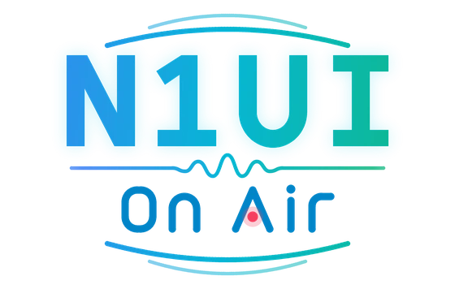

<section class="hero-card hero-card-padded" aria-label="N1UI station introduction">
  

    

      FCC Call Sign · N1UI
      <h1 class="hero-title">N1UI On Air</h1>
      

        
Guobiao Mei · Amateur Radio Station

        
          <svg viewBox="0 0 24 24" width="14" height="14" fill="none" stroke="currentColor" stroke-width="2" stroke-linecap="round" stroke-linejoin="round" aria-hidden="true">
            <path d="M20 10c0 6-8 12-8 12s-8-6-8-12a8 8 0 0 1 16 0Z"/>
            <circle cx="12" cy="10" r="3"/>
          </svg>
          Newton, Massachusetts
        
      

      

        <a class="action-pill action-pill-primary" href="mailto:n1ui@gmei.dev">
          <svg viewBox="0 0 24 24" width="16" height="16" fill="none" stroke="currentColor" stroke-width="2" stroke-linecap="round" stroke-linejoin="round" aria-hidden="true">
            <rect width="20" height="16" x="2" y="4" rx="2"/>
            <path d="m22 7-8.97 5.7a1.94 1.94 0 0 1-2.06 0L2 7"/>
          </svg>
          n1ui@gmei.dev
        </a>
        <a class="action-pill" href="https://www.qrz.com/db/n1ui">
          <svg viewBox="0 0 24 24" width="16" height="16" fill="none" stroke="currentColor" stroke-width="2" stroke-linecap="round" stroke-linejoin="round" aria-hidden="true">
            <circle cx="12" cy="12" r="10"/>
            <path d="M12 2a14.5 14.5 0 0 0 0 20 14.5 14.5 0 0 0 0-20"/>
            <path d="M2 12h20"/>
          </svg>
          QRZ Profile
        </a>
        <a class="action-pill action-pill-radio" href="https://www.levinecentral.com/ham/grid_square.php?Grid=FN42jh">
          <svg viewBox="0 0 24 24" width="16" height="16" fill="none" stroke="currentColor" stroke-width="2" stroke-linecap="round" stroke-linejoin="round" aria-hidden="true">
            <path d="M4.9 19.1C1 15.2 1 8.8 4.9 4.9"/>
            <path d="M7.8 16.2c-2.3-2.3-2.3-6.1 0-8.5"/>
            <circle cx="12" cy="12" r="2"/>
            <path d="M16.2 7.8c2.3 2.3 2.3 6.1 0 8.5"/>
            <path d="M19.1 4.9C23 8.8 23 15.1 19.1 19"/>
          </svg>
          Grid FN42jh
        </a>
      

    

    

      
    

  

</section>

<section class="section-block" aria-labelledby="heading-station">
  <h2 id="heading-station" class="section-heading">Station Overview</h2>
  

    

      

        <svg viewBox="0 0 24 24" width="18" height="18" fill="none" stroke="currentColor" stroke-width="2" stroke-linecap="round" stroke-linejoin="round">
          <path d="M4.9 19.1C1 15.2 1 8.8 4.9 4.9"/>
          <path d="M7.8 16.2c-2.3-2.3-2.3-6.1 0-8.5"/>
          <circle cx="12" cy="12" r="2"/>
          <path d="M16.2 7.8c2.3 2.3 2.3 6.1 0 8.5"/>
          <path d="M19.1 4.9C23 8.8 23 15.1 19.1 19"/>
        </svg>
      

      
<strong>N1UI</strong> is the personal amateur radio station of Guobiao Mei, licensed by the FCC and operating from Newton, Massachusetts, primarily on <a href="https://en.wikipedia.org/wiki/High_frequency">HF</a> (<a href="https://en.wikipedia.org/wiki/Single-sideband_modulation">SSB</a>).

    

    

      

        <svg viewBox="0 0 24 24" width="18" height="18" fill="none" stroke="currentColor" stroke-width="2" stroke-linecap="round" stroke-linejoin="round">
          <circle cx="12" cy="12" r="10"/>
          <polygon points="16.24 7.76 14.12 14.12 7.76 16.24 9.88 9.88 16.24 7.76"/>
        </svg>
      

      
Located in Maidenhead grid square <a href="https://www.levinecentral.com/ham/grid_square.php?Grid=FN42jh">FN42jh</a>. Station details and logs are available on <a href="https://www.qrz.com/db/n1ui">QRZ</a>.

    

    

      

        <svg viewBox="0 0 24 24" width="18" height="18" fill="none" stroke="currentColor" stroke-width="2" stroke-linecap="round" stroke-linejoin="round">
          <rect width="20" height="16" x="2" y="4" rx="2"/>
          <path d="m22 7-8.97 5.7a1.94 1.94 0 0 1-2.06 0L2 7"/>
        </svg>
      

      
Reachable on the air as <strong>N1UI</strong> or by email at <a href="mailto:n1ui@gmei.dev">n1ui@gmei.dev</a>.

    

  

</section>

<footer class="family-banner">
  
    <svg viewBox="0 0 24 24" width="15" height="15" fill="none" stroke="currentColor" stroke-width="2" stroke-linecap="round" stroke-linejoin="round">
      <path d="m3 9 9-7 9 7v11a2 2 0 0 1-2 2H5a2 2 0 0 1-2-2z"/>
      <polyline points="9 22 9 12 15 12 15 22"/>
    </svg>
  
  
Return to <a href="/">Guobiao's homepage</a>.

</footer>
